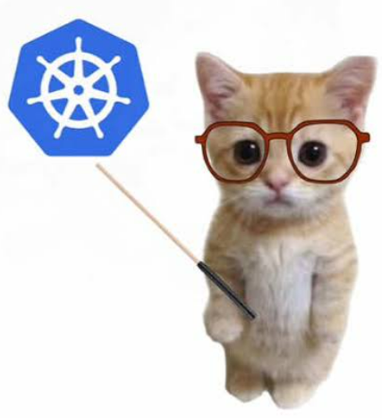

# Kubernetes (K8s)
<p align='center'></p>


## Structure and visualisation
Let us visualise it as a rack of physical servers

### Visualisation
```
Datacenter Rack
|--Physical Servers
```

Eg:
```
Datacenter Rack
|--Server A
|    |--Control Plane (Management brain)
|        |--Api Server
|        |--Scheduler
|        |--Control Manager
|        |--etcd
|--Server B
|    |--kubelet (local node employee/node agent)
|    |--container runtime (executes runtime)
|    |--Pods (workloads)
|        |--Pod
|        |   |--Container (nestJS)
|        |--Pod
|            |--Container (Redis)
|--Server C (worker node)
|   |--kubelet
|   |--Container runtime
|   |--Pods
|        |--Pod
|            |--Container (Postgres)
|--Server D (worker node)
    |--kubelet
    |--container runtime
    |--Pods
        |--Pod
            |--Container (Prometheus)
```

## Linux Basics
Now some linux basics first so that we understand the working of K8s in comparison to physical servers much easily.

```
Data Center Rack
|-- Server 1
|    |-- CPU, RAM, SSD/HDD, Network Card
|    |--Linux Kernel
|    |--Processes running
|        |--nginx PID 101
|        |--postgers PID 220
|        |--node app PID 450
|-- Server 2
|-- Server 3
.
.
.
```